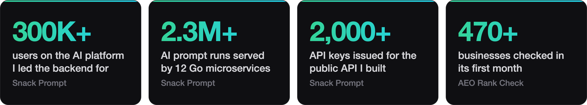
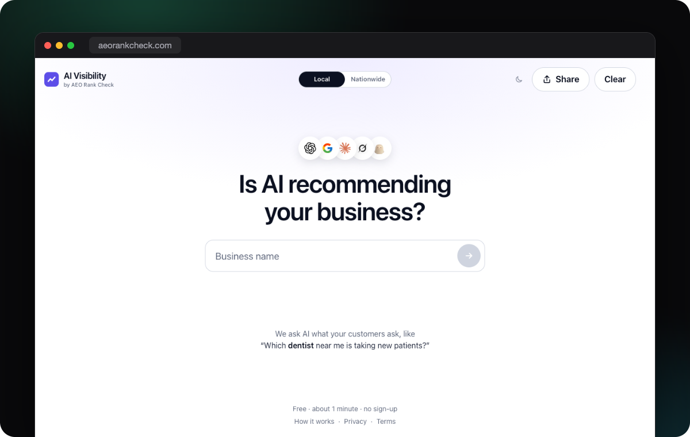
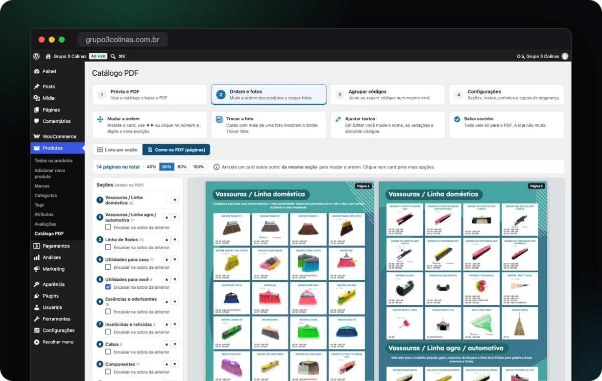
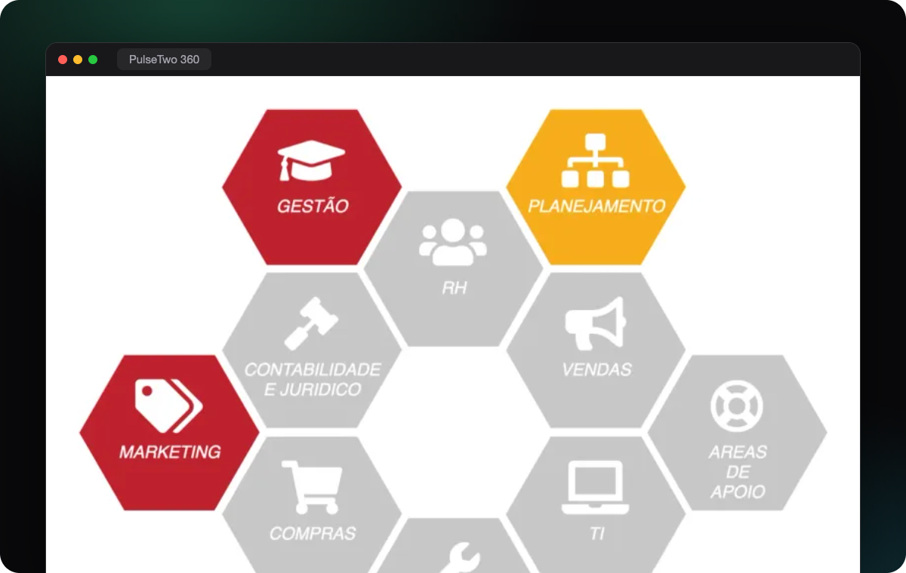
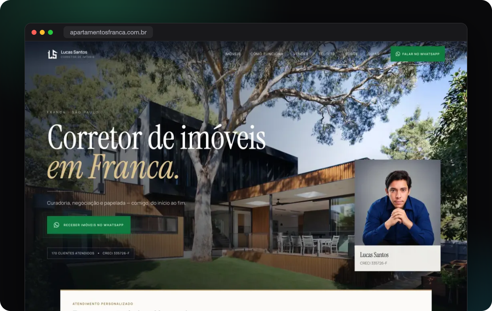

  

  
  
  
  

  I own products end to end: <b>what to build, the UX, the content quality and the system behind it</b>. 
  I work AI-native. Coding agents write most of the code, and I own the architecture, the review, the tests and the final quality users see.

 

  

## ✦ What I've shipped

<table>
  <tr>
    <td width="50%" valign="top">
      
      <h3>AEO Rank Check</h3>
      Asks ChatGPT, Google, Claude, Grok and Meta AI the questions customers ask, and shows whether a local business gets recommended over its competitors. <b>470+ businesses checked and 97 leads in its first month.</b>
        
      <code>Next.js</code> <code>LLM APIs</code> <code>Google Cloud</code> <code>DataForSEO</code>
    </td>
    <td width="50%" valign="top">
      
      <h3>WooCommerce PDF catalog</h3>
      WordPress plugin that turns 539 store products into a searchable, linked PDF catalog, replacing an image-only catalog an agency updated by hand. <b>Admin database queries cut from ~5,000 to ~50.</b>
        
      <code>PHP</code> <code>WooCommerce</code> <code>JavaScript</code> <code>Docker</code>
    </td>
  </tr>
  <tr>
    <td width="50%" valign="top">
      
      <h3>PulseTwo 360</h3>
      Business-diagnostics SaaS with subscriptions, payments and a per-area action plan for each company.
        
      <code>Svelte</code> <code>Hono</code> <code>Cloudflare</code>
    </td>
    <td width="50%" valign="top">
      
      <h3>Real estate lead-gen site</h3>
      Lead-generation site for a real estate broker, with 30 local SEO guides, AEO-ready structured data and leads straight to WhatsApp.
        
      <code>Next.js</code> <code>Cloudflare</code> <code>SEO/AEO</code>
    </td>
  </tr>
</table>

## ✦ Experience

| Role | Where | When |
|---|---|---|
| **Product Engineer, AI Search** | Snack Prompt (US) · on assignment to NexaRoofing | Jul 2026 – now |
| **Backend Lead** | Snack Prompt (US) · 12 Go microservices, 300K+ users | Jun 2024 – Jun 2026 |
| **Backend Developer** | Snack Prompt (US) | Jun 2023 – May 2024 |
| **Founder & AI Product Engineer** | [sola.dev.br](https://sola.dev.br) · freelance | Aug 2024 – now |
| **Full Stack Developer** | OTicket · ticketing platform | Feb 2022 – Jun 2023 |

## ✦ Open source here

- [**pulse-api**](https://github.com/LeonardoSola/pulse-api): REST WhatsApp API in Go with multi-device management, RabbitMQ queues, PostgreSQL and Docker.
- [**whatsapp-go-boilerplate**](https://github.com/LeonardoSola/whatsapp-go-boilerplate): a clean starting point for WhatsApp bots in Go, built on whatsmeow.
- [**gym-helper**](https://github.com/LeonardoSola/gym-helper): Flutter app with a rest timer and set counter for the gym.

## ✦ Stack

  

**AI:** LLM integrations (OpenAI, Claude) · LLM pipelines · AI agents · MCP · Claude Code · SEO/AEO/GEO

**Homelab:** a Debian server running 15+ Docker services behind Caddy and Tailscale (n8n, PostgreSQL, Redis, Home Assistant, Vaultwarden), plus staging environments for client reviews.

---

  <b>Open to Product Engineer · AI Engineer · Tech Lead · Founding Engineer roles, remote.</b> 
  Brazil · English and Portuguese

<!--- Sola --->
<!-- Oi, eu sou um EasterEGG! 😁🥚 --->
